<div align="center">

# 🔎 Titanic Exploratory Data Analysis (EDA)

### Understanding the data with statistics and visualizations


</div>

---

## 🎯 Objective
**Understand data using statistics and visualizations**: summary statistics, distributions, outliers, feature relationships, patterns and anomalies in the Titanic dataset (891 passengers, 12 columns, target: `Survived`).

**Tools:** Pandas · Matplotlib · Seaborn · Plotly

## ⚡ Key Findings

| | |
|---|---|
| 🚺 **Sex** | Women survived at **74.2%**, men at only **18.9%** |
| 🎫 **Class** | 1st **63.0%** · 2nd **47.3%** · 3rd **24.2%** |
| 👑 **Sex × Class** | 1st-class women **96.8%**, 3rd-class men **13.5%** |
| 👶 **Age** | Children (0-12) **58%**, seniors (60+) **22.7%** |
| 💰 **Fare** | Survival climbs from **19.7%** (cheapest quartile) to **58.1%** (priciest) |
| 👪 **Family** | Alone **30.4%**, families of 2-4 **55-72%**, families of 5+ **0-33%** |
| 🗂️ **Cabin** | Cabin recorded **66.7%** vs not recorded **30.0%** |

## 🔄 Pipeline


## 📂 Project Structure

```
task2-eda-titanic/
├── 📁 data/
│   └── Titanic-Dataset.csv          # raw dataset (891 rows, 12 columns)
├── 📁 images/                       # 13 static plots from the notebook
├── 📁 plots_html/                   # 5 interactive Plotly charts (open in a browser)
├── 📓 data_exploration.ipynb        # full EDA notebook with outputs
├── 📄 requirements.txt
└── 📄 README.md
```

## 📊 Step 1: Summary Statistics

| Feature | Mean | Median | Std | Skewness | Missing |
|---|---|---|---|---|---|
| `Age` | 29.70 | 28.00 | 14.53 | 0.39 | 177 |
| `Fare` | 32.20 | 14.45 | 49.69 | **4.79** | 0 |
| `SibSp` | 0.52 | 0.00 | 1.10 | 3.70 | 0 |
| `Parch` | 0.38 | 0.00 | 0.81 | 2.75 | 0 |

Overall survival rate: **38.4%** (342 of 891). Missing values: `Cabin` 687 (77.1%), `Age` 177 (19.9%), `Embarked` 2 (0.2%). No duplicate rows.

## 📈 Step 2: Histograms & Boxplots
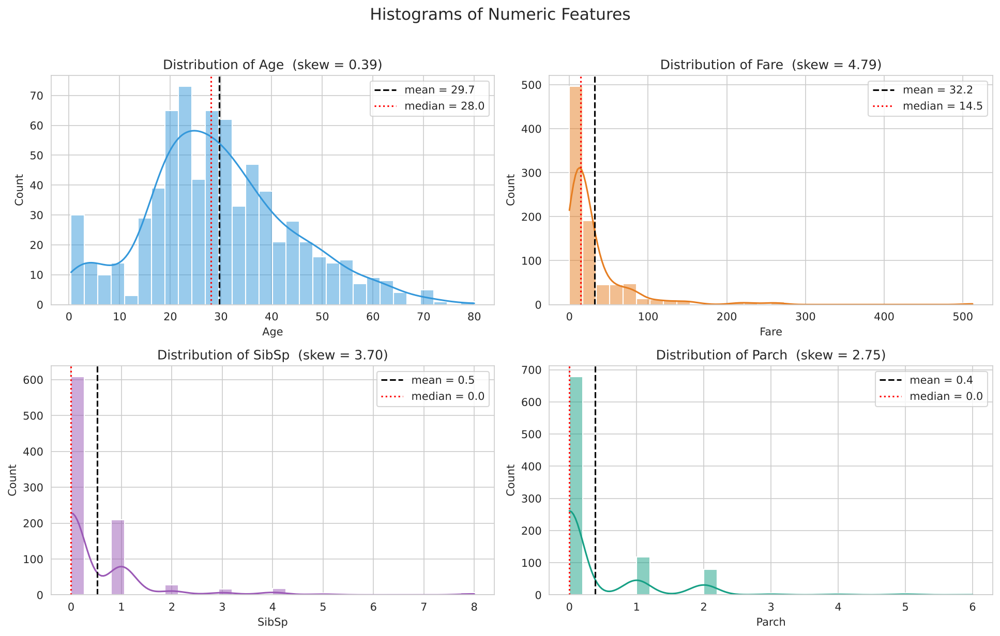
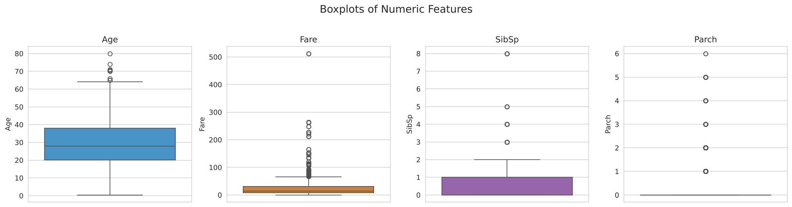
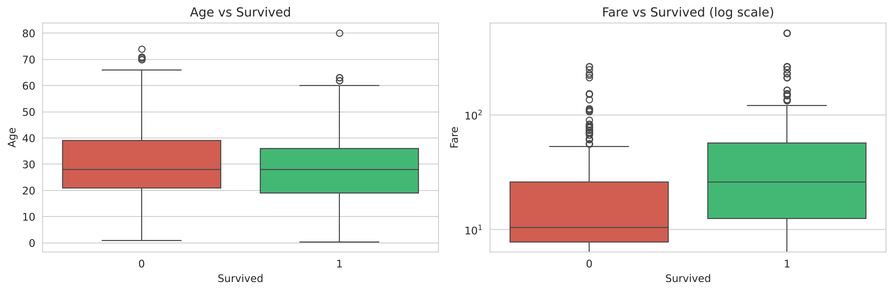

- `Age` is roughly bell-shaped; `Fare` has a long right tail (**116 IQR outliers**) and needs a log transform
- The `SibSp` / `Parch` "outliers" are genuine: most passengers travelled alone

## 🧮 Step 3: Categorical Features
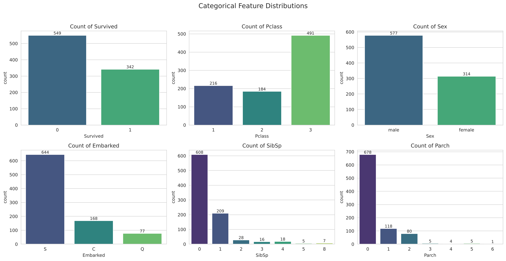
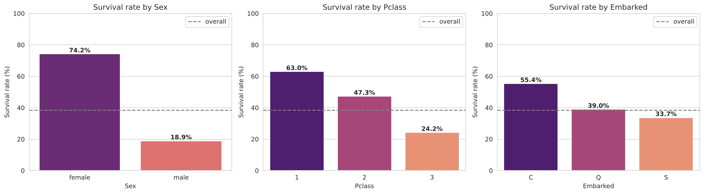

## 🔗 Step 4: Feature Relationships
| Correlation matrix | Correlation with Survived |
|---|---|
| 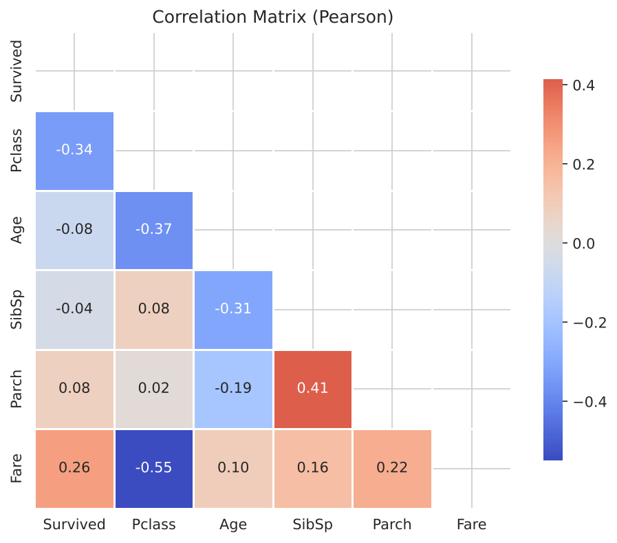 | 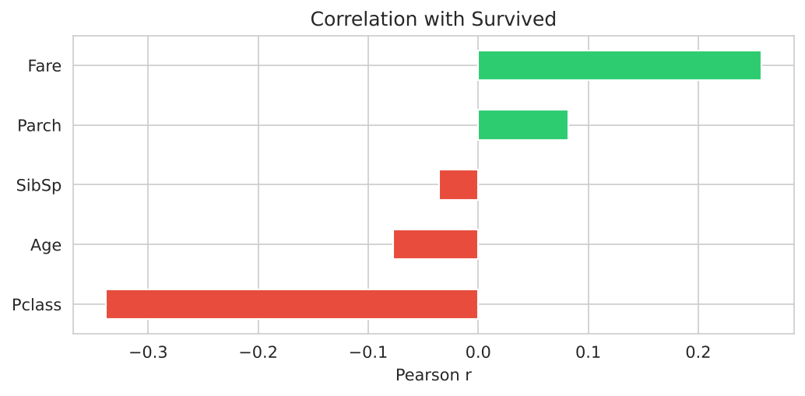 |

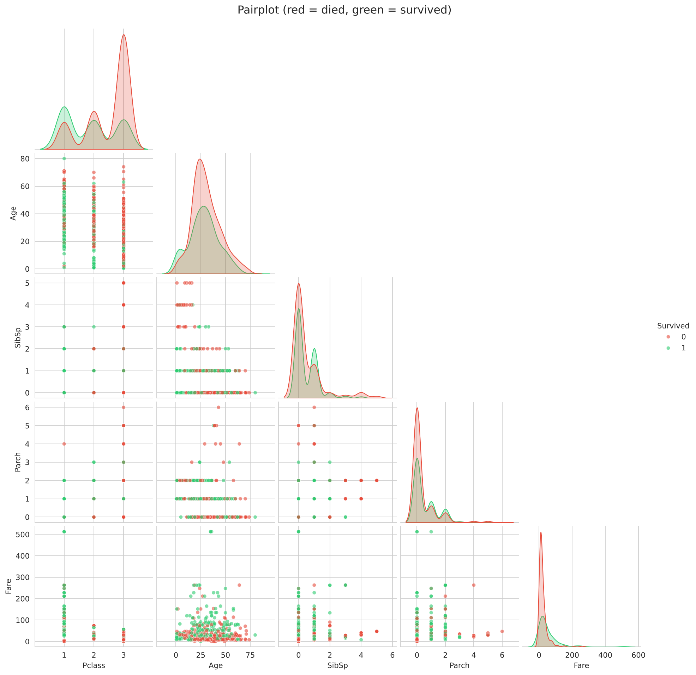

- Strongest pair: **Pclass ↔ Fare (r ≈ −0.55)**
- **Multicollinearity check:** all VIFs are between 1.2 and 1.7, so it is not a problem here

## 🔎 Step 5: Patterns & Anomalies
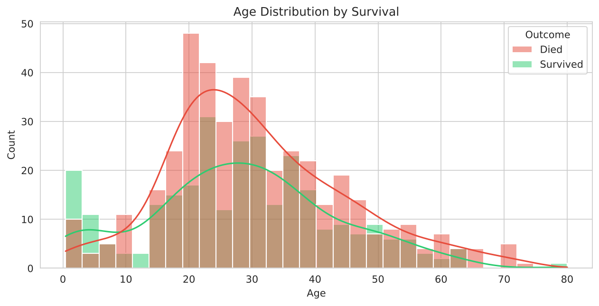
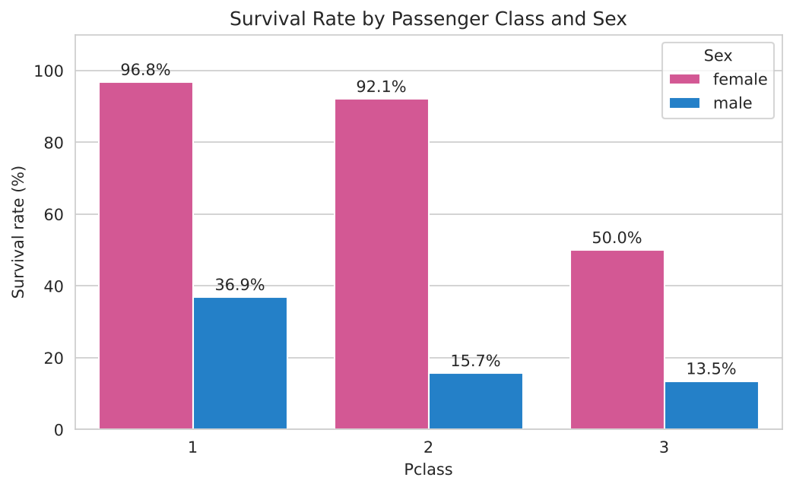
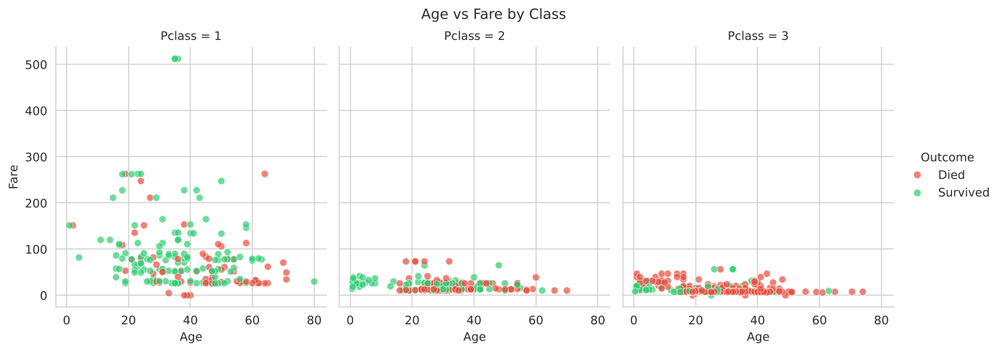
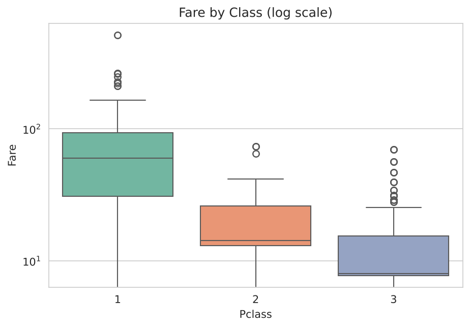
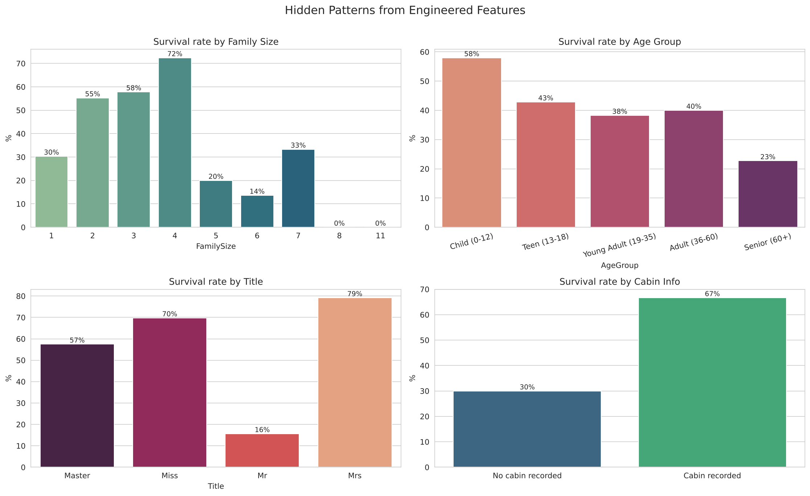

> 🖱️ Interactive versions of the Plotly charts are in [`plots_html/`](plots_html/). Download and open them in a browser to hover, zoom and filter.

**Anomalies found**
- 15 passengers paid **Fare = 0** (likely crew or data gaps)
- 3 passengers share the maximum fare of **512.33**
- `Age` is missing far more often in 3rd class (**27.7%**) than in 2nd (**6.0%**), so it is **not** missing at random
- `Cabin` is 77% missing, mostly third class, so the missingness itself carries information

## 🧠 Step 6: Feature-Level Inferences

| Feature | Inference |
|---|---|
| `Sex` | Strongest single predictor (women and children first) |
| `Pclass` | Social class strongly affected survival |
| `Age` | Young children prioritised; the elderly fared worst |
| `Fare` | Mostly a proxy for class; heavily skewed, so log-transform it |
| `Embarked` | Cherbourg's higher survival (55.4%) reflects more 1st-class passengers (51%), not the port itself |
| `FamilySize` | Small families helped; very large families fared badly |
| `Title` | Captures sex, age and marital status in one feature |
| `HasCabin` | A recorded cabin signals wealth; a useful engineered feature |

**Modelling recommendations:** keep `Sex`, `Pclass`, `Age`, log(`Fare`), `FamilySize`, `HasCabin`/`Title`; impute `Age` by group; keep the `SibSp`/`Parch` outliers.

## ▶️ How to Run
```bash
git clone https://github.com/D0027/task2-eda-titanic.git
cd task2-eda-titanic
pip install -r requirements.txt
jupyter notebook data_exploration.ipynb
```
Also runs on Kaggle: add the Titanic dataset via **+ Add Input** and click **Run All**.

## 🎤 Interview Questions

<details>
<summary><b>1. What is the purpose of EDA?</b></summary>

To understand the data before modelling: structure, distributions, missing values, outliers, relationships and anomalies, so you can make good preprocessing and modelling decisions.
</details>

<details>
<summary><b>2. How do boxplots help in understanding a dataset?</b></summary>

They summarise the median, quartiles, spread and outliers in one picture and make it easy to compare distributions across groups.
</details>

<details>
<summary><b>3. What is correlation and why is it useful?</b></summary>

A measure (−1 to +1) of how strongly two variables move together. It helps find predictive features and redundant ones. Correlation does not imply causation.
</details>

<details>
<summary><b>4. How do you detect skewness in data?</b></summary>

Histogram/KDE shape, the gap between mean and median, and `df.skew()` (|skew| > 1 is strongly skewed). Fix with log, square-root or Box-Cox transforms.
</details>

<details>
<summary><b>5. What is multicollinearity?</b></summary>

When predictors are highly correlated with each other, making linear-model coefficients unstable. Detect it with a correlation matrix or VIF (> 5-10); fix by dropping or combining features, regularization or PCA.
</details>

<details>
<summary><b>6. What tools do you use for EDA?</b></summary>

Pandas, NumPy, Matplotlib, Seaborn and Plotly, plus profiling libraries such as ydata-profiling or Sweetviz.
</details>

<details>
<summary><b>7. A time when EDA helped you find a problem?</b></summary>

On the Titanic data, EDA showed `Age` was missing far more often in third class (27.7% vs 6.0% in second) and `Fare` was heavily skewed, so I chose group-wise imputation and a log transform instead of one global fix.
</details>

<details>
<summary><b>8. What is the role of visualization in ML?</b></summary>

It reveals patterns, outliers and data-quality issues, guides feature engineering and model choice, and helps evaluate and explain results (confusion matrix, ROC curve, feature importance).
</details>

## 👤 Author

**Deepak Yadav**

[](https://github.com/D0027)
[](https://linkedin.com/in/deepakyadav027)
[](https://d0027.github.io)
